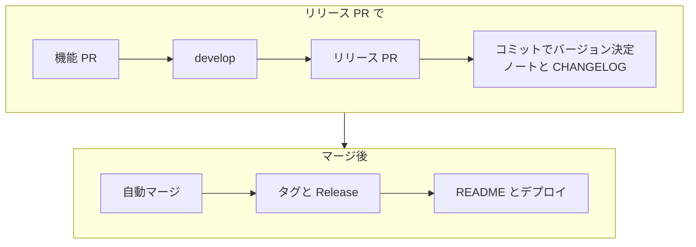
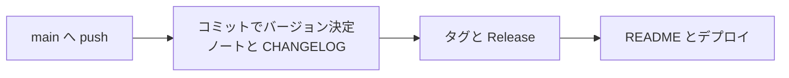

<div align="center">

[English](README.md) · [한국어](README.ko.md) · [简体中文](README.zh-CN.md) · **日本語**

# project-auto-wizard

**コマンド 1 つで、バージョン管理、CHANGELOG、GitHub Release、CI/CD をリポジトリに導入します。**

インストールされるのは、すべてあなた自身のリポジトリ内の通常の GitHub Actions です。API キーもホスティングサービスも不要です。

[ドキュメント](https://twin-fang.github.io/project-auto-wizard/ja/) · [GitHub で体験](#try-it) · [クイックスタート](#quickstart) · [変更履歴](CHANGELOG.md)

[](https://github.com/Twin-Fang/project-auto-wizard/actions/workflows/CI.yaml)
[](https://www.npmjs.com/package/project-auto-wizard)
[](https://www.npmjs.com/package/project-auto-wizard)
[](LICENSE)
[](package.json)


</div>

## 最新バージョン

最新バージョンと変更履歴の全文は [CHANGELOG.md](CHANGELOG.md) を参照してください。

## project-auto-wizard とは？

新しいプロジェクトでは、最初の機能を作る前に毎回同じ作業が発生します。バージョンの上げ方を決め、CHANGELOG を管理し、リリースノートを書き、リリースにタグを付け、前のプロジェクトから CI/CD ワークフローをコピーしてきます。数時間かかり、リポジトリごとに少しずつ違うものになります。

project-auto-wizard は、この設定を一度で済ませます。リポジトリで実行していくつかの質問に答えると、通常の GitHub Actions ワークフローといくつかのスクリプトを `.github/` に書き込みます。それ以降はコミットメッセージが次のバージョンを決めます。`feat:` はマイナー、`fix:` はパッチ、`!` はメジャーを上げます。`develop` から `main` へ PR を開くと、ワークフローがリリースノートを書き、CHANGELOG を更新し、マージして `vX.Y.Z` タグを付け、GitHub Release を公開します。

これはリリースサービスではなく、セットアップのためのツールです。棚を組み立てて去っていく大工のようなものです。リポジトリの外で動くものも、外部へ通信するものもなく、書き込まれたファイルはすべて自分で読み、変更し、削除できます。

<a id="try-it"></a>

## GitHub ですぐに体験

すべて GitHub の中で動き、各ステップを英語または韓国語で説明します。パソコンへのインストールも Secret も不要です。

[](https://codespaces.new/Twin-Fang/project-auto-wizard-example?quickstart=1)

1. **インストーラーを実行（2 分）。** ボタンを押すと[サンプルリポジトリ](https://github.com/Twin-Fang/project-auto-wizard-example)で Codespace（ブラウザ上の VS Code とターミナル）が開きます。`npm run try:install` を実行すると、本物のウィザードが Node・Spring・Python のサンプルプロジェクトにインストールします。
2. **実際にリリース（5 分）。** [テンプレートをコピー](https://github.com/new?template_name=project-auto-wizard-example&template_owner=Twin-Fang)し、コピー先で Codespace を開いて（**Code > Codespaces**）`npm run try:release` を実行します。リリース PR を開くと、GitHub Actions がバージョン確定、リリースノートと CHANGELOG の作成、マージ、Release の公開まで行います。


手順ガイド（英語）とクリックだけで行う方法：[Try it on GitHub](https://twin-fang.github.io/project-auto-wizard/start/try-it/)

<a id="quickstart"></a>

## クイックスタート

リポジトリのルートで実行します（Node.js 20.12 以上）:

1. **インストール。** プロジェクトタイプを検出し、ブランチ戦略、デプロイ方式、Copilot による要約を使うかを尋ねます。デフォルトのままで構いません。

   ```bash
   npx project-auto-wizard
   ```

   ✓ `.github/workflows/PROJECT-COMMON-*.yaml`、`.github/scripts/`、`version.yml` ができ、`README.md` の末尾に `Latest Version` セクションが付きます。

2. **ワークフローが依存するリポジトリ設定を確認します。**

   ```bash
   npx project-auto-wizard --mode doctor
   ```

   ✓ すべての項目が OK になるか、どこで何を変えればよいかが出力されます。

3. **コミット、push、`develop` の作成。**

   ```bash
   git add .github version.yml README.md   # ウィザードが追記した場合は .gitignore も
   git commit -m "chore: add release automation"
   git push origin main && git push origin main:develop
   ```

   ✓ **Actions** タブで、`main` の `PROJECT-RELEASE-PUBLISH` と `README VERSION UPDATE` がリリースを作らずに成功します。

4. **リリース。** `develop` に `feat: …` をコミットし、`develop` から `main` へ PR を開きます。

   ✓ 1 分以内に PR にリリースノートのコメントが付いて `github-actions` がマージし、**Releases** に `vX.Y.Z` が現れます。

CI やスクリプトからは質問なしで実行します: `npx project-auto-wizard --mode full --force --type spring,react`。`--dry-run` を付けると何も書き込まずにプレビューします。

メッセージの言語は英語または韓国語（`en` | `ko`）です。使う言語が決まっていない場合、対話型ウィザードは最初に言語を尋ねます。`--lang` でも指定できます。`--lang`、環境変数 `PROJECT_AUTO_WIZARD_LANG`、`version.yml` の `language` の順に優先されます。環境変数はその実行にのみ適用され、有効な保存済み `language` は上書きしません（有効な値がない場合のみ保存）。上書きするには `--lang` を使います。

## インストールされるもの

たとえば Spring プロジェクトでは次のようになります:

```text
your-repo/
├── .github/
│   ├── workflows/
│   │   ├── PROJECT-COMMON-AUTO-CHANGELOG-CONTROL.yaml   # リリース PR: 次のバージョン、ノート、CHANGELOG、自動マージ
│   │   ├── PROJECT-COMMON-RELEASE-PUBLISH.yaml          # vX.Y.Z タグと GitHub Release
│   │   ├── PROJECT-COMMON-RELEASE-PR-MERGED.yaml        # squash や rebase でマージしたリリース PR を公開
│   │   ├── PROJECT-COMMON-VERSION-CONTROL.yaml          # main への直接 push でパッチリリース
│   │   ├── PROJECT-COMMON-README-VERSION-UPDATE.yaml    # README の "Latest Version" 行を更新
│   │   ├── PROJECT-COMMON-AI-PR-SUMMARY.yaml            # 機能 PR の要約コメント
│   │   ├── PROJECT-COMMON-ISSUE-HELPER.yaml             # 新しい issue にブランチ名とコミットメッセージ
│   │   └── PROJECT-SPRING-*.yml / *.yaml                # スタック向けの CI、PR プレビュー、デプロイ
│   ├── scripts/*.py                                     # ワークフローの処理（Python 標準ライブラリ）
│   └── .wizard/baseline.json                            # インストール記録。更新時に自分の変更を残すために使用
├── version.yml                                          # 単一の情報源: バージョン、タイプ、パス、ブランチ、オプション
└── README.md                                            # + "Latest Version" セクション
```

`CHANGELOG.md` と `CHANGELOG.json` は最初のリリースで作成されます。

| インストール対象 | 用途 |
|---|---|
| `.github/workflows/PROJECT-COMMON-*.yaml` | リリース自動化: バージョン更新、リリース PR のノート、CHANGELOG、タグと GitHub Release、README のバージョン行、PR 要約コメント、新しい issue へのブランチ名の提案 |
| `.github/workflows/PROJECT-<TYPE>-*` | 使用するスタック（Spring、Flutter、React、Next.js、Python、Go）向けの CI/CD |
| `.github/scripts/*.py` | ワークフローの実処理。標準ライブラリのみの Python |
| `version.yml` | バージョン、プロジェクトタイプ、パス、ブランチ、オプションの単一の情報源 |
| `README.md` のバージョンセクション | リリースのたびに最新の状態へ更新 |

これらのファイルはあなたのものなので、自由に読んだり編集したりできます。ウィザードを再実行すると更新されます。編集済みのファイルは、上流のバージョンが変わっていなければそのまま残り、双方が変わっている場合は、自分のファイルを残す、バックアップして置き換える、新しいバージョンを横に追加する、のいずれかを選べます。

## リリースの流れ

デフォルトの `pr-flow` 戦略（`develop` → `main`）:



`trunk-based`（リリースブランチが開発ブランチを兼ねる）では、`main` への push ごとにリリースされます:



リリースノートはデフォルトでルールベースです。GitHub Copilot（Copilot AI Credits を消費します）を有効にすることも、OpenAI 互換の API を指定することもできます。モデルが使えない場合や失敗した場合はルールベースに戻るため、要約の手順が原因でリリースが止まることはありません。

## 実際のリポジトリのための設計

- **デフォルト設定のまま動きます。** リリース自動化に Secret も個人アクセストークンも不要で、組織のデフォルトのワークフロー権限（read）で動作します。各ワークフローは必要な権限を自分で宣言します。
- **どのマージ方法でも公開されます。** リリース PR を merge commit、squash、rebase のどれでマージしても公開され、`main` への直接 push ではパッチリリースが作られ、テンプレートから作った新しいリポジトリでは作られません。
- **保護されたブランチは隠さず説明します。** ルールが自動マージを止めた場合は、どのルールが原因で何を変えればよいかを実行ログに残し、手動でマージしたリリース PR も公開されます。
- **自分の変更は更新でも残ります。** 更新はインストール記録と比較して、編集したファイルを残します。`--dry-run`、`--mode status`、`--mode doctor`、`--mode uninstall` ですべての変更を確認・取り消しできます。
- **テストされています。** PR ごとに Node.js 20、22、24 と Linux、Windows で 1,800 以上の Node.js テストと 300 以上の Python テストが動き、リリースの流れは実際の GitHub リポジトリで最初から最後まで確認して、結果を issue に記録しています。

## 対応するプロジェクトタイプ

| タイプ | 検出元 | リリース自動化に加えてインストールされるもの |
|---|---|---|
| `spring` | `build.gradle`、`build.gradle.kts`、`pom.xml` | CI、サーバーへのデプロイ（単一サーバー / Nginx または Traefik によるダウンタイムなし）、PR プレビュー |
| `flutter` | `pubspec.yaml` | CI、Android（Firebase、Play Store、セルフホスト、テスト用 APK）、iOS TestFlight |
| `react`（React / Next.js） | `package.json` の `react` または `next` dependency | CI、CI + CD |
| `python` | `pyproject.toml`、`setup.py`、`requirements.txt` | CI、PR プレビュー、サーバーへのデプロイ |
| `go` | `go.mod` | CI、PR プレビュー、サーバーへのデプロイ |
| `node`、`react-native`、`react-native-expo`、`basic` | `package.json` / フォールバック | リリース自動化のみ |

1 つのリポジトリに複数のタイプを置けます（`--type spring,react`）。モノレポのサブフォルダーは `--paths "flutter=app,react=client"` で指定します。

<a id="post-install"></a>

## インストール後に確認すること

| 項目 | すること |
|---|---|
| Workflow permissions | インストールされるワークフローは、必要な権限を自分で宣言します。自分のワークフローがデフォルト値に依存している場合のみ、Settings → Actions → General → Workflow permissions を **Read and write permissions** に設定してください |
| Merge commit | リリース PR が automerge できるよう、merge commit を許可してください |
| `WORKFLOW_PAT`（任意） | なくても、`GITHUB_TOKEN` によるフォールバックが約 20 秒後に、リリースブランチのデプロイワークフローを含めてリリースを完了させます。Release イベントで起動する独自のワークフローを追加する場合のみ必要です。bot または machine アカウントで発行してください（scopes: `repo`、`workflow`） |
| Copilot 要約（任意） | デフォルトはオフ。Copilot AI Credits を消費します。組織では、組織に課金される Copilot CLI を許可する必要があります |

<a id="flutter-store"></a>

Flutter のストアデプロイ（Play Store、Firebase、TestFlight）の設定は、[ドキュメントサイトの Flutter ページ](https://twin-fang.github.io/project-auto-wizard/project-types/flutter/)にあります。

## 導入前と導入後

| | 導入前 | project-auto-wizard を使うと |
|---|---|---|
| 初期設定 | 古いリポジトリからワークフローをコピーして調整 | `npx project-auto-wizard` を実行し、いくつかの質問に答える |
| 次のバージョン | 手で決めて手で入力 | リリース PR のコミットタイプから算出 |
| CHANGELOG | 手書きで、省かれがち | リリース PR のマージ時に更新 |
| タグと Release | 手動で作成 | マージ後に自動作成 |
| スタックごとの CI/CD | プロジェクトごとに作成 | 検出したタイプ向けにインストール |
| AI 要約 | API キーと独自スクリプトが必要 | 任意。ルールベースならキー不要 |

## 他のツールとの比較

| | project-auto-wizard | release-please | semantic-release | changesets |
|---|---|---|---|---|
| 導入方法 | 編集可能なワークフローファイルをインストール | GitHub Action + 設定 | CI で実行する npm パッケージ + プラグイン | CLI + GitHub Action |
| バージョンの決定基準 | コミットタイプ（Conventional でないコミット → patch） | Conventional Commits | Conventional Commits（設定可能） | 開発者が書く changeset ファイル |
| リリース PR | あり（または trunk-based） | あり | なし。push 時にリリース | あり（"Version Packages"） |
| npm / PyPI への公開 | しない | しない | プラグインで可能 | 可能（npm） |
| スタックごとの CI/CD を含む | 含む（プロジェクトタイプ別） | なし | なし | なし |
| モノレポ | タイプ別のパス、共通の 1 つのバージョン | パッケージごとのバージョン | コミュニティプラグイン | パッケージごとのバージョン |

他のツールのほうが優れている点:

- **release-please** は成熟していて広く使われており、多くのエコシステムのバージョンファイルを更新でき、モノレポで独立したバージョンのパッケージも扱えます。
- **semantic-release** は手作業なしで npm などのレジストリに公開でき、プラグインのエコシステムが大きいです。
- **changesets** は、多数のパッケージを公開する JavaScript のモノレポに最適で、変更内容をコミットから導出せず人が書きます。

## 使うべきとき、使わないとき

次の場合に使います:

- リポジトリを新しく始め、初日からリリースが動く状態にしたい
- チームが `develop` を `main` にマージしていて、ノートと CHANGELOG 付きのリリース PR がほしい
- Spring、Flutter、React、Next.js、Python、Go のプロジェクトで、CI/CD とリリース自動化を 1 回の設定で導入したい
- 1 つのリポジトリに複数のスタック（例: Spring のバックエンドと React のフロントエンド）があり、バージョンを共有している

次の場合は使いません:

- 単一パッケージがすでに release-please や semantic-release で問題なくリリースできている
- リリース自体がパッケージレジストリへの公開を伴う必要がある（このリポジトリが npm 向けにしているように、Release イベントで動く独自のワークフローを追加してください。`GITHUB_TOKEN` で作成したリリースは他のワークフローを起動しないため、`WORKFLOW_PAT` が必要です）
- パッケージごとに独立したバージョンが必要
- リポジトリが GitHub 上にない

## ドキュメント

ドキュメント全体は [twin-fang.github.io/project-auto-wizard](https://twin-fang.github.io/project-auto-wizard/ja/) にあり、英語と韓国語で読めます。中国語（簡体字）と日本語はトップページとクイックスタートのみで、それ以外のページは英語で表示されます。内容は次のとおりです:

- すべての CLI オプション、`--mode status`、`--mode doctor`、`--dry-run`、`--mode uninstall`
- Flutter のストアデプロイ、デプロイモード、必要な secret、`ExportOptions.plist`
- リリースノートエンジンのチェーンと Copilot の課金
- タイプごとのワークフローの詳細、実行ログ、設計方針、アーキテクチャ

## コントリビュート

issue と pull request を歓迎します。`develop` からブランチを作り、`develop` に対して PR を開いてください。セットアップとテスト（`npm test`）は [CONTRIBUTING.md](CONTRIBUTING.md) を参照してください。このリポジトリは、自身がインストールするワークフローで自分自身をリリースしています。

## 由来と謝辞

このプロジェクトは [Cassiiopeia/projectops](https://github.com/Cassiiopeia/projectops)（MIT、Copyright (c) 2025 Cassiiopeia）の GitHub Actions 自動化テンプレートから発展しました。ワークフローの構成や名前の一部（例: `PROJECT-COMMON-*` ワークフロー）はその成果を引き継いでおり、project-auto-wizard はそれを `npx` インストーラーとして再構成し拡張したものです。原作の著作権表示は [LICENSE](LICENSE) に残しています。

## ライセンス

[MIT](LICENSE)
