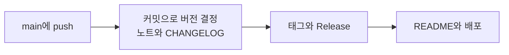

<div align="center">

[English](README.md) · **한국어** · [简体中文](README.zh-CN.md) · [日本語](README.ja.md)

# project-auto-wizard

**명령 한 번으로 버전 관리, CHANGELOG, GitHub Release, CI/CD를 레포에 설치합니다.**

설치되는 것은 전부 내 레포 안의 일반 GitHub Actions입니다. API 키도, 외부 서비스도 필요 없습니다.

[문서](https://twin-fang.github.io/project-auto-wizard/ko/) · [브라우저에서 체험](#try-it) · [빠른 시작](#quickstart) · [변경 기록](CHANGELOG.md)

[](https://github.com/Twin-Fang/project-auto-wizard/actions/workflows/CI.yaml)
[](https://www.npmjs.com/package/project-auto-wizard)
[](https://www.npmjs.com/package/project-auto-wizard)
[](LICENSE)
[](package.json)


</div>

## 최신 버전

최신 버전과 전체 변경 기록은 [CHANGELOG.md](CHANGELOG.md)에서 확인하세요.

## project-auto-wizard란?

새 프로젝트는 첫 기능을 만들기 전에 늘 같은 일부터 합니다. 버전을 어떻게 올릴지 정하고, CHANGELOG를 관리하고, 릴리스 노트를 쓰고, 릴리스에 태그를 달고, 지난 프로젝트의 CI/CD 워크플로우를 복사해 옵니다. 몇 시간이 걸리고, 레포마다 조금씩 달라집니다.

project-auto-wizard는 이 설정을 한 번에 끝냅니다. 레포에서 실행하고 질문 몇 개에 답하면 `.github/`에 일반 GitHub Actions 워크플로우와 스크립트 몇 개를 씁니다. 그 뒤로는 커밋 메시지가 다음 버전을 정합니다. `feat:`는 minor, `fix:`는 patch, `!`는 major를 올립니다. `develop`에서 `main`으로 PR을 열면 워크플로우가 릴리스 노트를 쓰고, CHANGELOG를 갱신하고, 머지한 뒤 `vX.Y.Z` 태그를 달고 GitHub Release를 발행합니다.

릴리스 서비스가 아니라 설정 도구입니다. 선반을 짜 주고 떠나는 목수와 같습니다. 레포 밖에서 도는 것도, 외부로 연락하는 것도 없고, 설치한 파일은 모두 직접 읽고 고치고 지울 수 있습니다.

<a id="try-it"></a>

## 브라우저만으로 5분 체험

[예제 레포](https://github.com/Twin-Fang/project-auto-wizard-example)에 이미 설치되어 있습니다. **Use this template**으로 복사하고, `develop` 브랜치를 만들고, 웹 편집기에서 `feat: …` 커밋을 한 뒤 `main`으로 PR을 여세요. 1분 안에 GitHub Actions가 버전을 확정하고, 릴리스 노트를 쓰고, 머지한 뒤 태그와 GitHub Release, CHANGELOG를 만듭니다. 모두 자기 레포에서 일어나며 설치나 Secret은 필요 없습니다.


단계마다 무엇을 확인하면 되는지 담은 가이드: [브라우저에서 직접 해 보기](https://twin-fang.github.io/project-auto-wizard/ko/start/try-it/) · [한국어 자막 영상](https://raw.githubusercontent.com/Twin-Fang/project-auto-wizard/main/assets/demo/try-it.ko.mp4)

<a id="quickstart"></a>

## 빠른 시작

레포 루트에서 실행합니다(Node.js 20.12 이상).

1. **설치.** 프로젝트 타입을 감지하고 브랜치 전략, 배포 방식, Copilot 요약 사용 여부를 묻습니다. 기본값을 그대로 써도 됩니다.

   ```bash
   npx project-auto-wizard
   ```

   ✓ `.github/workflows/PROJECT-COMMON-*.yaml`, `.github/scripts/`, `version.yml`이 생기고, `README.md` 끝에 `Latest Version` 섹션이 붙습니다.

2. **레포 설정 점검.** 워크플로우가 의존하는 설정을 확인합니다.

   ```bash
   npx project-auto-wizard --mode doctor
   ```

   ✓ 모든 항목이 OK이거나, 무엇을 어디서 바꿔야 하는지 출력됩니다.

3. **커밋, push, `develop` 만들기.**

   ```bash
   git add .github version.yml README.md   # 마법사가 항목을 추가했다면 .gitignore도
   git commit -m "chore: add release automation"
   git push origin main && git push origin main:develop
   ```

   ✓ **Actions** 탭에서 `main`의 `PROJECT-RELEASE-PUBLISH`와 `README VERSION UPDATE`가 릴리스를 만들지 않고 성공합니다.

4. **릴리스.** `develop`에 `feat: …`를 커밋하고 `develop`에서 `main`으로 PR을 엽니다.

   ✓ 1분 안에 PR에 릴리스 노트 댓글이 달리고 `github-actions`가 머지하며, **Releases**에 `vX.Y.Z`가 생깁니다.

CI나 스크립트에서는 질문 없이 실행합니다: `npx project-auto-wizard --mode full --force --type spring,react`. `--dry-run`을 붙이면 아무것도 쓰지 않고 미리 봅니다.

메시지 언어는 영어 또는 한국어(`en` | `ko`)입니다. 어떤 언어를 쓸지 정해진 것이 없으면 대화형 마법사가 가장 먼저 언어를 묻고, `--lang`으로도 지정할 수 있습니다. `--lang`, 환경변수 `PROJECT_AUTO_WIZARD_LANG`, `version.yml`의 `language` 순서로 우선 적용됩니다. 환경변수는 그 실행에만 적용되며 저장된 유효한 `language`를 덮어쓰지 않습니다(유효한 값이 없을 때만 저장). 덮어쓰려면 `--lang`을 쓰세요.

## 설치되는 것

예를 들어 Spring 프로젝트에는 다음이 생깁니다.

```text
your-repo/
├── .github/
│   ├── workflows/
│   │   ├── PROJECT-COMMON-AUTO-CHANGELOG-CONTROL.yaml   # 릴리스 PR: 다음 버전, 노트, CHANGELOG, 자동 머지
│   │   ├── PROJECT-COMMON-RELEASE-PUBLISH.yaml          # vX.Y.Z 태그와 GitHub Release
│   │   ├── PROJECT-COMMON-RELEASE-PR-MERGED.yaml        # squash·rebase로 머지한 릴리스 PR 발행
│   │   ├── PROJECT-COMMON-VERSION-CONTROL.yaml          # main 직접 push의 patch 릴리스
│   │   ├── PROJECT-COMMON-README-VERSION-UPDATE.yaml    # README "Latest Version" 줄 갱신
│   │   ├── PROJECT-COMMON-AI-PR-SUMMARY.yaml            # 기능 PR 요약 댓글
│   │   ├── PROJECT-COMMON-ISSUE-HELPER.yaml             # 새 이슈에 브랜치명과 커밋 메시지
│   │   └── PROJECT-SPRING-*.yml / *.yaml                # 스택별 CI, PR 프리뷰, 배포
│   ├── scripts/*.py                                     # 워크플로우의 로직 (Python 표준 라이브러리)
│   └── .wizard/baseline.json                            # 설치 기록, update 때 사용자 수정을 지키는 데 사용
├── version.yml                                          # 단일 출처: 버전, 타입, 경로, 브랜치, 옵션
└── README.md                                            # + "Latest Version" 섹션
```

`CHANGELOG.md`와 `CHANGELOG.json`은 첫 릴리스 때 생깁니다.

| 설치 항목 | 용도 |
|---|---|
| `.github/workflows/PROJECT-COMMON-*.yaml` | 릴리스 자동화: 버전 증가, 릴리스 PR 노트, CHANGELOG, 태그와 GitHub Release, README 버전 줄, PR 요약 댓글, 새 이슈의 브랜치명 제안 |
| `.github/workflows/PROJECT-<TYPE>-*` | 사용하는 스택(Spring, Flutter, React, Next.js, Python, Go)의 CI/CD |
| `.github/scripts/*.py` | 워크플로우의 실제 로직. 표준 라이브러리만 쓰는 Python |
| `version.yml` | 버전, 프로젝트 타입, 경로, 브랜치, 옵션의 단일 출처 |
| `README.md` 버전 섹션 | 릴리스 때마다 최신 상태로 갱신 |

설치된 파일은 직접 읽고 수정해도 됩니다. 마법사를 다시 실행하면 파일을 업데이트합니다. 사용자가 수정한 파일은 원본 버전이 바뀌지 않았다면 그대로 두고, 양쪽이 모두 바뀌었다면 내 파일 유지, 백업 후 교체, 새 버전을 옆에 추가 중에서 고르게 합니다.

## 릴리스가 흘러가는 방식

기본 `pr-flow` 전략(`develop` → `main`):


`trunk-based`(릴리스 브랜치가 곧 개발 브랜치)에서는 `main`에 push할 때마다 릴리스됩니다.



릴리스 노트는 기본적으로 규칙 기반입니다. GitHub Copilot(Copilot AI Credits 사용)을 켜거나 OpenAI 호환 API를 지정할 수 있습니다. 모델을 쓸 수 없거나 실패하면 규칙 기반으로 돌아가므로, 요약 단계 때문에 릴리스가 막히는 일은 없습니다.

## 실제 레포를 위한 설계

- **기본 설정 그대로 동작합니다.** 릴리스 자동화에는 Secret도 개인 액세스 토큰도 필요 없고, 조직의 기본 워크플로우 권한(read)에서 돕니다. 워크플로우마다 필요한 권한을 직접 선언합니다.
- **어떤 머지 방식이든 발행됩니다.** 릴리스 PR을 merge commit, squash, rebase 중 무엇으로 머지해도 발행되고, `main`에 직접 push하면 patch 릴리스가 생기며, 템플릿으로 만든 새 레포에는 생기지 않습니다.
- **보호된 브랜치는 숨기지 않고 설명합니다.** 규칙 때문에 자동 머지가 막히면 어떤 규칙이 막았고 무엇을 바꾸면 되는지 실행 로그에 남기고, 사람이 직접 머지한 릴리스 PR도 발행됩니다.
- **사용자 수정은 업데이트에서도 지켜집니다.** 업데이트는 설치 기록과 비교해 사용자가 고친 파일을 유지하고, `--dry-run`, `--mode status`, `--mode doctor`, `--mode uninstall`로 모든 변경을 확인하고 되돌릴 수 있습니다.
- **테스트됩니다.** PR마다 Node.js 20, 22, 24와 Linux, Windows에서 Node.js 테스트 1,800개 이상과 Python 테스트 300개 이상이 돌고, 릴리스 흐름은 실제 GitHub 레포에서 처음부터 끝까지 밟아 결과를 이슈에 기록합니다.

## 지원 프로젝트 타입

| 타입 | 감지 기준 | 릴리스 자동화에 더해 설치되는 것 |
|---|---|---|
| `spring` | `build.gradle`, `build.gradle.kts`, `pom.xml` | CI, 서버 배포 (단일 서버 / Nginx·Traefik 무중단), PR 프리뷰 |
| `flutter` | `pubspec.yaml` | CI, Android (Firebase, Play Store, self-hosted, 테스트 APK), iOS TestFlight |
| `react` (React / Next.js) | `package.json`의 `react` 또는 `next` dependency | CI, CI + CD |
| `python` | `pyproject.toml`, `setup.py`, `requirements.txt` | CI, PR 프리뷰, 서버 배포 |
| `go` | `go.mod` | CI, PR 프리뷰, 서버 배포 |
| `node`, `react-native`, `react-native-expo`, `basic` | `package.json` / fallback | 릴리스 자동화만 |

한 레포에 여러 타입을 둘 수 있고(`--type spring,react`), 모노레포 하위 폴더는 `--paths "flutter=app,react=client"`로 지정합니다.

<a id="post-install"></a>

## 설치 후 확인할 것

| 항목 | 할 일 |
|---|---|
| Workflow permissions | 설치된 워크플로우는 필요한 권한을 각자 선언합니다. 직접 만든 워크플로우가 기본값에 의존할 때만 Settings → Actions → General → Workflow permissions를 **Read and write permissions**로 바꾸세요 |
| Merge commit | 릴리스 PR이 automerge되려면 merge commit을 허용하세요 |
| `WORKFLOW_PAT` (선택) | 없어도 `GITHUB_TOKEN` 폴백이 릴리스 브랜치의 배포 워크플로우까지 약 20초 뒤에 마무리합니다. Release 이벤트로 트리거되는 워크플로우를 직접 추가할 때만 필요합니다. bot 또는 machine 계정으로 발급하세요 (scopes: `repo`, `workflow`) |
| Copilot 요약 (선택) | 기본 꺼짐. Copilot AI Credits를 사용하며, 조직은 조직에 과금되는 Copilot CLI를 허용해야 합니다 |

<a id="flutter-store"></a>

Flutter 스토어 배포(Play Store, Firebase, TestFlight) 설정은 [문서 사이트의 Flutter 페이지](https://twin-fang.github.io/project-auto-wizard/ko/project-types/flutter/)에 있습니다.

## 있을 때와 없을 때

| | 없을 때 | project-auto-wizard 사용 시 |
|---|---|---|
| 초기 설정 | 예전 레포의 워크플로우를 복사해 고침 | `npx project-auto-wizard` 실행 후 질문 몇 개에 답함 |
| 다음 버전 | 사람이 정해서 직접 입력 | 릴리스 PR의 커밋 타입에서 산출 |
| CHANGELOG | 손으로 작성, 자주 빠뜨림 | 릴리스 PR이 병합될 때 갱신 |
| 태그와 Release | 수동 생성 | 병합 후 자동 생성 |
| 스택별 CI/CD | 프로젝트마다 새로 작성 | 감지된 타입에 맞게 설치 |
| AI 요약 | API 키와 별도 스크립트 필요 | 선택 사항. 규칙 기반은 키 없이 동작 |

## 다른 도구와 비교

| | project-auto-wizard | release-please | semantic-release | changesets |
|---|---|---|---|---|
| 추가 방식 | 수정 가능한 워크플로우 파일 설치 | GitHub Action + 설정 | CI에서 실행하는 npm 패키지 + 플러그인 | CLI + GitHub Action |
| 버전 결정 기준 | 커밋 타입 (Conventional이 아닌 커밋 → patch) | Conventional Commits | Conventional Commits (설정 가능) | 개발자가 작성하는 changeset 파일 |
| 릴리스 PR | 있음 (또는 trunk-based) | 있음 | 없음, push 시 릴리스 | 있음 ("Version Packages") |
| npm / PyPI 배포 | 안 함 | 안 함 | 플러그인으로 가능 | 가능 (npm) |
| 스택별 CI/CD 포함 | 포함, 프로젝트 타입별 | 없음 | 없음 | 없음 |
| 모노레포 | 타입별 경로, 하나의 공유 버전 | 패키지별 버전 | 커뮤니티 플러그인 | 패키지별 버전 |

다른 도구가 더 나은 점:

- **release-please**는 성숙했고 널리 쓰이며, 여러 생태계의 버전 파일을 갱신하고 모노레포에서 독립 버전 패키지를 다룹니다.
- **semantic-release**는 수동 단계 없이 npm 등 레지스트리에 배포하고 플러그인 생태계가 큽니다.
- **changesets**는 여러 패키지를 배포하는 JavaScript 모노레포에 가장 잘 맞고, 변경 내역을 커밋에서 뽑지 않고 사람이 직접 씁니다.

## 언제 쓰고, 언제 쓰지 말아야 하나

이런 경우에 씁니다:

- 새 레포를 시작하며 첫날부터 릴리스가 동작하게 하고 싶을 때
- 팀이 `develop`을 `main`에 병합하고, 노트와 CHANGELOG가 포함된 릴리스 PR을 원할 때
- Spring, Flutter, React, Next.js, Python, Go 프로젝트에서 CI/CD와 릴리스 자동화를 한 번에 설정하고 싶을 때
- 한 레포에 여러 스택(예: Spring 백엔드와 React 프론트엔드)이 있고 버전을 공유할 때

이런 경우에는 쓰지 않습니다:

- 패키지 하나가 이미 release-please나 semantic-release로 잘 릴리스되고 있을 때
- 릴리스 자체가 패키지 레지스트리에 배포까지 해야 할 때 (이 레포가 npm에 배포하듯 Release 이벤트에 직접 워크플로우를 추가하세요. 이때 `WORKFLOW_PAT`이 필요합니다. `GITHUB_TOKEN`으로 만든 릴리스는 다른 워크플로우를 트리거하지 않기 때문입니다)
- 패키지마다 독립된 버전이 필요할 때
- 레포가 GitHub에 있지 않을 때

## 문서

전체 문서는 [twin-fang.github.io/project-auto-wizard](https://twin-fang.github.io/project-auto-wizard/ko/)에 영어와 한국어로 있습니다. 중국어(간체)와 일본어는 첫 화면과 빠른 시작을 다루며, 나머지 페이지는 영어로 표시됩니다. 다음 내용을 다룹니다:

- 모든 CLI 옵션, `--mode status`, `--mode doctor`, `--dry-run`, `--mode uninstall`
- Flutter 스토어 배포, 배포 모드, 필요한 secret, `ExportOptions.plist`
- 릴리스 노트 엔진 체인과 Copilot 과금
- 타입별 워크플로우 상세, 실행 로그, 설계 원칙, 아키텍처

## 기여하기

이슈와 풀 리퀘스트를 환영합니다. `develop`에서 브랜치를 만들고 `develop`을 대상으로 PR을 여세요. 설정과 테스트(`npm test`)는 [CONTRIBUTING.md](CONTRIBUTING.md)를 참고하세요. 이 레포는 마법사가 설치하는 워크플로우로 스스로 릴리스됩니다.

## 출처와 감사

이 프로젝트는 [Cassiiopeia/projectops](https://github.com/Cassiiopeia/projectops)(MIT, Copyright (c) 2025 Cassiiopeia)의 GitHub Actions 자동화 템플릿에서 출발했습니다. 워크플로우 구조와 이름 일부(예: `PROJECT-COMMON-*` 워크플로우)는 해당 작업에서 이어졌고, project-auto-wizard는 이를 `npx` 설치기로 다시 구성하고 확장했습니다. 원작의 저작권 고지는 [LICENSE](LICENSE)에 유지합니다.

## 라이선스

[MIT](LICENSE)
