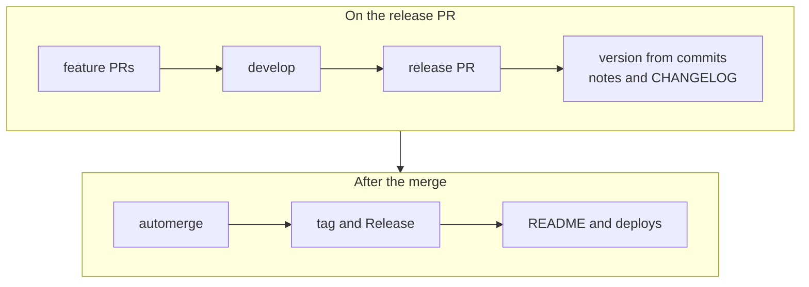
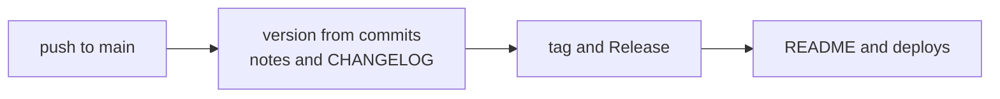

<div align="center">

**English** · [한국어](README.ko.md) · [简体中文](README.zh-CN.md) · [日本語](README.ja.md)

# project-auto-wizard

**One command sets up versioning, CHANGELOG, GitHub Releases and CI/CD in your repo.**

Everything it installs is plain GitHub Actions in your own repository. No API keys, no hosted service.

[Docs](https://twin-fang.github.io/project-auto-wizard/) · [Run it on GitHub, no install](#try-it) · [Quickstart](#quickstart) · [Changelog](CHANGELOG.md)

[](https://github.com/Twin-Fang/project-auto-wizard/actions/workflows/CI.yaml)
[](https://www.npmjs.com/package/project-auto-wizard)
[](https://www.npmjs.com/package/project-auto-wizard)
[](LICENSE)
[](package.json)


</div>

<!-- AUTO-VERSION-SECTION: DO NOT EDIT MANUALLY -->
## Latest Version : v1.0.2 (2026-10-17)

[Full release history](CHANGELOG.md)

## What is project-auto-wizard?

Every new project starts with the same chores before the first feature: decide how versions go up, keep a CHANGELOG, write release notes, tag releases, and copy CI/CD workflows over from the last project. It takes hours, and each repository ends up slightly different.

project-auto-wizard does that setup once. Run it in your repository, answer a few questions, and it writes ordinary GitHub Actions workflows and a few scripts into `.github/`. From then on your commit messages decide the next version: a `feat:` raises the minor version, a `fix:` the patch, a `!` the major. Open a pull request from `develop` to `main` and the workflows write the release notes, update the CHANGELOG, merge, tag `vX.Y.Z` and publish a GitHub Release.

It is a setup tool, not a release service. Think of it as a carpenter who builds the shelves and leaves: nothing runs outside your repository, nothing calls home, and every file it writes is yours to read, change or remove.

<a id="try-it"></a>

## Run it on GitHub, no install

Everything runs inside GitHub, explained step by step in English or Korean. No install on your computer, no secrets.

[](https://codespaces.new/Twin-Fang/project-auto-wizard-example?quickstart=1)

1. **Run the installer (2 min).** Click the button: a Codespace (VS Code and a terminal in your browser) opens on the [example repository](https://github.com/Twin-Fang/project-auto-wizard-example). Run `npm run try:install` and the real wizard sets up a sample Node, Spring or Python project.
2. **Cut a real release (5 min).** [Copy the template](https://github.com/new?template_name=project-auto-wizard-example&template_owner=Twin-Fang), open a Codespace on your copy (**Code > Codespaces**) and run `npm run try:release`. It opens the release PR, and GitHub Actions confirms the version, writes the notes and CHANGELOG, merges and publishes the Release.


Step-by-step guide with screens, and the same release with clicks only: [Run it on GitHub, no install](https://twin-fang.github.io/project-auto-wizard/start/try-it/) · [video (MP4)](https://raw.githubusercontent.com/Twin-Fang/project-auto-wizard/main/assets/demo/try-codespaces.mp4)

<a id="quickstart"></a>

## Quickstart

In the root of your repository (Node.js 20.12 or later):

1. **Install.** It detects your project type and asks about the branch strategy, the deploy style and Copilot summaries. The defaults are fine.

   ```bash
   npx project-auto-wizard
   ```

   ✓ `.github/workflows/PROJECT-COMMON-*.yaml`, `.github/scripts/` and `version.yml` exist, and `README.md` ends with a `Latest Version` section.

2. **Check the repository settings** the workflows depend on.

   ```bash
   npx project-auto-wizard --mode doctor
   ```

   ✓ Every item is OK, or the output says what to change and where.

3. **Commit, push, and create `develop`.**

   ```bash
   git add .github version.yml README.md   # and .gitignore if the wizard added entries
   git commit -m "chore: add release automation"
   git push origin main && git push origin main:develop
   ```

   ✓ The **Actions** tab shows `PROJECT-RELEASE-PUBLISH` and `README VERSION UPDATE` succeeding on `main`, without creating a release.

4. **Release.** Commit `feat: …` to `develop` and open a pull request from `develop` to `main`.

   ✓ Within a minute the PR gets a release-notes comment and is merged by `github-actions`, and **Releases** shows `vX.Y.Z`.

For CI or scripts, run it without prompts: `npx project-auto-wizard --mode full --force --type spring,react`. Add `--dry-run` to preview without writing anything.

Messages are in English or Korean (`en` | `ko`). The interactive wizard asks for the language first when nothing says which one to use; you can also pick one with `--lang`, the `PROJECT_AUTO_WIZARD_LANG` environment variable, or `language` in `version.yml`, in that order of precedence. The environment variable applies to that run only and does not overwrite a valid saved `language` (it is saved only when there is none); `--lang` does.

## What you get

A Spring project, for example, ends up with:

```text
your-repo/
├── .github/
│   ├── workflows/
│   │   ├── PROJECT-COMMON-AUTO-CHANGELOG-CONTROL.yaml   # release PR: next version, notes, CHANGELOG, automerge
│   │   ├── PROJECT-COMMON-RELEASE-PUBLISH.yaml          # tag vX.Y.Z and GitHub Release
│   │   ├── PROJECT-COMMON-RELEASE-PR-MERGED.yaml        # publishes release PRs merged with squash or rebase
│   │   ├── PROJECT-COMMON-VERSION-CONTROL.yaml          # patch release for direct pushes to main
│   │   ├── PROJECT-COMMON-README-VERSION-UPDATE.yaml    # keeps the README "Latest Version" line current
│   │   ├── PROJECT-COMMON-AI-PR-SUMMARY.yaml            # summary comment on feature PRs
│   │   ├── PROJECT-COMMON-ISSUE-HELPER.yaml             # branch name and commit message on new issues
│   │   └── PROJECT-SPRING-*.yml / *.yaml                # CI, PR preview and deploy for your stack
│   ├── scripts/*.py                                     # the logic behind the workflows (Python standard library)
│   └── .wizard/baseline.json                            # install record, used to keep your edits on update
├── version.yml                                          # single source: version, types, paths, branches, options
└── README.md                                            # + "Latest Version" section
```

`CHANGELOG.md` and `CHANGELOG.json` appear with the first release.

| Installed | Purpose |
|---|---|
| `.github/workflows/PROJECT-COMMON-*.yaml` | Release automation: version bump, release PR notes, CHANGELOG, tag and GitHub Release, README version line, PR summary comments, branch-name suggestions on new issues |
| `.github/workflows/PROJECT-<TYPE>-*` | CI/CD for your stack (Spring, Flutter, React, Next.js, Python, Go) |
| `.github/scripts/*.py` | The logic behind the workflows, standard-library Python only |
| `version.yml` | Single source of the version, project types, paths, branches and options |
| `README.md` version section | Kept up to date after every release |

The files are yours to read and edit. Running the wizard again updates them: files you changed are kept when the upstream version did not change, and when both changed it asks whether to keep yours, replace with a backup, or add the new version alongside.

## How a release flows

With the default `pr-flow` strategy (`develop` → `main`):



With `trunk-based` (the release branch is also the development branch), every push to `main` is a release:



Release notes are rule-based by default. You can turn on GitHub Copilot (uses your Copilot AI Credits) or point it at any OpenAI-compatible API. If a model is unavailable or fails, it falls back to the rules, so a release is never blocked by the summary step.

## Built for real repositories

- **Works with default settings.** Release automation needs no secrets and no personal access token, and runs under an organization's default workflow permission (read). Each workflow declares the permissions it needs.
- **Every merge method publishes.** A release PR merged with a merge commit, squash or rebase is published; a direct push to `main` gets a patch release; a new repository created from a template does not.
- **Protected branches are explained, not hidden.** When a rule blocks the automatic merge, the run says which rule and what to change, and a release PR you merge by hand still publishes.
- **Your edits survive updates.** Updates compare against the install record and keep files you changed; `--dry-run`, `--mode status`, `--mode doctor` and `--mode uninstall` show and undo every change.
- **Tested.** Over 1,800 Node.js and 300 Python tests run on every pull request on Node.js 20, 22 and 24, Linux and Windows. Release flows are exercised end to end on real GitHub repositories, with the results recorded in the issues.

## Supported project types

| Type | Detected from | Installed on top of release automation |
|---|---|---|
| `spring` | `build.gradle`, `build.gradle.kts`, `pom.xml` | CI, server deploy (single server / zero-downtime Nginx or Traefik), PR preview |
| `flutter` | `pubspec.yaml` | CI, Android (Firebase, Play Store, self-hosted, test APK), iOS TestFlight |
| `react` (React / Next.js) | `package.json` with a `react` or `next` dependency | CI, CI + CD |
| `python` | `pyproject.toml`, `setup.py`, `requirements.txt` | CI, PR preview, server deploy |
| `go` | `go.mod` | CI, PR preview, server deploy |
| `node`, `react-native`, `react-native-expo`, `basic` | `package.json` / fallback | Release automation only |

Several types can live in one repo (`--type spring,react`), and monorepo subfolders are set with `--paths "flutter=app,react=client"`.

<a id="post-install"></a>

## After installing

| Item | What to do |
|---|---|
| Workflow permissions | The installed workflows declare their own permissions. Set Settings → Actions → General → Workflow permissions to **Read and write permissions** only if your own workflows rely on the default |
| Merge commits | Allow merge commits so the release PR can automerge |
| `WORKFLOW_PAT` (optional) | Without it, a `GITHUB_TOKEN` fallback finishes the release, including the deploy workflows on the release branch, about 20 seconds later. Required only if you add your own workflows triggered by the Release event. Issue it from a bot or machine account (scopes: `repo`, `workflow`) |
| Copilot summaries (optional) | Off by default. Uses Copilot AI Credits; organizations must allow Copilot CLI billed to the organization |

<a id="flutter-store"></a>

Flutter store deployment (Play Store, Firebase, TestFlight) setup is described in the [Flutter page of the docs site](https://twin-fang.github.io/project-auto-wizard/project-types/flutter/).

## Without / with

| | Without | With project-auto-wizard |
|---|---|---|
| Initial setup | Copy workflows from an older repo and adapt them | `npx project-auto-wizard`, answer a few prompts |
| Next version | Decided and typed by hand | Derived from commit types in the release PR |
| CHANGELOG | Written by hand, often skipped | Updated when the release PR merges |
| Tags and Releases | Created manually | Created after merge |
| CI/CD per stack | Written per project | Installed for the detected types |
| AI summaries | Need an API key and custom scripting | Optional; rule-based works with no keys |

## Compared to other tools

| | project-auto-wizard | release-please | semantic-release | changesets |
|---|---|---|---|---|
| How it's added | Installs editable workflow files | GitHub Action + config | npm package run in CI + plugins | CLI + GitHub Action |
| Version decided by | Commit types (non-conventional commits → patch) | Conventional Commits | Conventional Commits (configurable) | Changeset files written by developers |
| Release PR | Yes (or trunk-based) | Yes | No, releases on push | Yes ("Version Packages") |
| Publishes to npm / PyPI | No | No | Yes, via plugins | Yes (npm) |
| Stack CI/CD included | Yes, per project type | No | No | No |
| Monorepo | Per-type paths, one shared version | Per-package versions | Community plugins | Per-package versions |

What the others do better:

- **release-please** is mature and widely used, updates version files for many ecosystems, and handles independently versioned packages in a monorepo.
- **semantic-release** publishes to npm and other registries with no manual step and has a large plugin ecosystem.
- **changesets** is the best fit for JavaScript monorepos publishing many packages, with changelog entries written by people rather than derived from commits.

## When to use it, and when not to

Use it if:

- you are starting a repo and want releases working from day one
- your team merges `develop` into `main` and wants a release PR with notes and a CHANGELOG
- you have a Spring, Flutter, React, Next.js, Python or Go project and want CI/CD and release automation from one setup
- one repo holds several stacks (for example a Spring backend and a React frontend) that share a version

Skip it if:

- a single package already releases fine with release-please or semantic-release
- the release itself must publish to a package registry (add your own workflow on the Release event, as this repo does for npm; this needs `WORKFLOW_PAT`, because releases created with `GITHUB_TOKEN` don't trigger other workflows)
- your packages need independent versions
- the repository is not on GitHub

## Documentation

The full documentation is at [twin-fang.github.io/project-auto-wizard](https://twin-fang.github.io/project-auto-wizard/), in English and Korean. Simplified Chinese and Japanese cover the landing page and quickstart; other pages fall back to English. It covers:

- every CLI option, `--mode status`, `--mode doctor`, `--dry-run` and `--mode uninstall`
- Flutter store deployment, deploy modes, required secrets and `ExportOptions.plist`
- the release notes engine chain and Copilot billing
- per-type workflow details, run logs, design principles and architecture

## Contributing

Issues and pull requests are welcome. Branch from `develop` and open PRs against `develop`; see [CONTRIBUTING.md](CONTRIBUTING.md) for setup and tests (`npm test`). This repository releases itself with the workflows it installs.

- [ARCHITECTURE.md](ARCHITECTURE.md) — module map, install pipeline, `@wizard` marker grammar, how updates compare files
- [ADDING-A-PROJECT-TYPE.md](ADDING-A-PROJECT-TYPE.md) — step-by-step guide to adding a project type
- [CONTRIBUTING.md](CONTRIBUTING.md) — dev setup and pull request rules

## Origin & Acknowledgements

This project grew out of the GitHub Actions automation templates of [Cassiiopeia/projectops](https://github.com/Cassiiopeia/projectops) (MIT, Copyright (c) 2025 Cassiiopeia). Some of the workflow structure and naming (for example the `PROJECT-COMMON-*` workflows) carries over from that work; project-auto-wizard repackages and extends it as an `npx` installer. The original copyright notice is kept in [LICENSE](LICENSE).

## License

[MIT](LICENSE)
